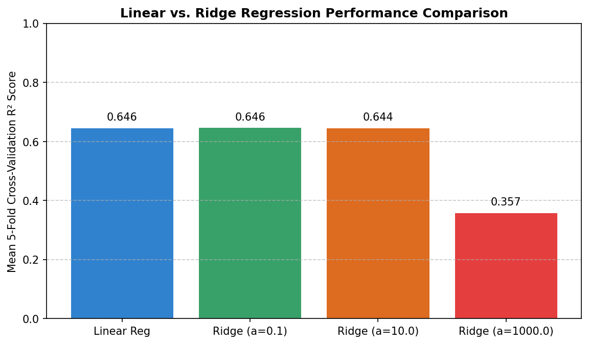
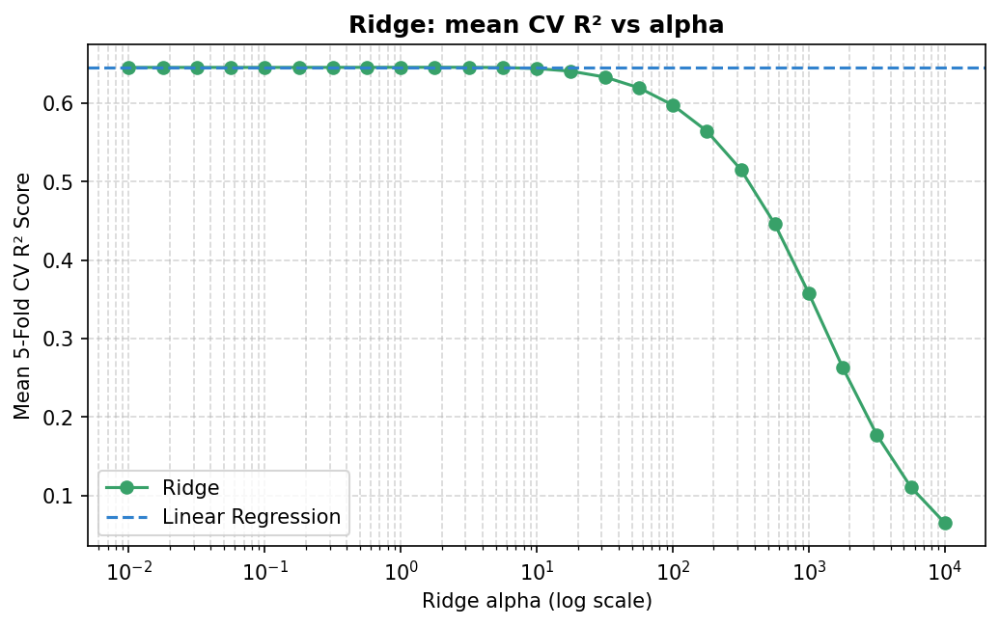

# SC5002 Lab Assignment: Search Algorithms & Regularised Regression

NTU **SC5002 Artificial Intelligence Fundamentals & Applications**, AY2026/27 Semester 1.

The assignment has two parts:
1. **Classical search, worked by hand.** BFS and A\* on a weighted directed graph, and A\* on the 8-puzzle.
2. **Applied machine learning, low-code.** Linear Regression vs Ridge Regression on the California Housing dataset, compared with 5-fold cross-validation over several regularisation strengths.

Generative AI was used as a learning partner: Claude helped check the assignment work, including the Task 1.2 A* tree. The relevant exchanges are recorded in [`docs/ai-responses/`](docs/ai-responses/).

---

## Repository structure

```
part2/
  SC5002_Part2.ipynb       Colab notebook (course template + explanations + optional extensions)
  model_comparison.png     Bar chart: mean 5-fold CV R² per model
  alpha_sweep.png          Optional: CV R² across 25 alpha values (log scale)
docs/
  SC5002 Lab_Assignment 2026S1.pdf  Official assignment brief
  ai-responses/            Exact prompts and full AI responses for every Learn-with-AI task
pyproject.toml             Dependencies for local use
uv.lock                    Locked dependency versions for local use
```

## How to run

**Google Colab (recommended).** Upload `part2/SC5002_Part2.ipynb` to [Colab](https://colab.research.google.com/) and choose *Runtime → Run all*. Nothing needs installing, and the dataset downloads automatically.

**Locally** (Python ≥ 3.10, [uv](https://docs.astral.sh/uv/)):
```bash
uv sync
uv run jupyter lab part2/SC5002_Part2.ipynb
```

Everything uses `random_state=42`, so the numbers below reproduce exactly.

---

## Part 1: Search results

### Task 1.1: Weighted graph (start S, goal G)

| Algorithm | Path | Cost | Why |
|---|---|---|---|
| BFS | S → F → G | 9 | Finds the path with the fewest edges and ignores edge costs |
| A\* (f = g + h) | S → B → D → G | **7 (optimal)** | Uses real cost so far plus an admissible estimate of the rest |

- The heuristic is **admissible** (it never overestimates the true cost to G). It is **not consistent**: on edge B→D, h(B) = 5 > 2 + h(D). A\* still returns the optimal path. The full expansion table is in the separately submitted report PDF.
- **h(B) = 5 is admissible** because the true shortest cost from B to G is 6 and 5 ≤ 6.

### Task 1.2: 8-puzzle (g = depth, h = misplaced tiles)

```
2 8 3     1 2 3
1 6 4 ──► 8 _ 4      Solution: 5 moves (blank Up, Up, Left, Down, Right), 6 nodes expanded
7 _ 5     7 6 5
```
f stays at 4–5 along the solution path. Ties at f = 5 are broken by lower h, then by move order Up, Right, Down, Left. Repeated states reached with a higher g are omitted from the final tree. The hand-drawn search tree is in the separately submitted report PDF.

---

## Part 2: Machine learning results

**Setup:** 1,000 random rows of California Housing. The target is `MedHouseVal`, the median house value in $100k. There are 8 numeric features (income, house age, rooms, bedrooms, population, occupancy, latitude, longitude). Features are standardised with `StandardScaler`, then split 80/20. Models are scored by 5-fold cross-validated R² on the training split.

| Model | Mean CV R² | Fold std | Train R² |
|---|---|---|---|
| Linear Regression | **0.6457** | 0.0536 | 0.6617 |
| Ridge α = 0.1 | **0.6457** | 0.0536 | 0.6617 |
| Ridge α = 10 | **0.6443** | 0.0526 | 0.6599 |
| Ridge α = 1000 | **0.3574** | 0.0363 | 0.4030 |



### Key insights
1. **Small α makes almost no difference, because Linear Regression wasn't overfitting.** Its train R² (0.662) is barely above its CV R² (0.646), so Ridge has little variance to remove. The 0.0014 gap between Linear and Ridge α = 10 is much smaller than the ~0.05 spread across folds, so it's effectively a tie.
2. **α = 1000 underfits.** The penalty pushes every coefficient toward zero, and the model drifts toward predicting the average house value. Train and CV R² are *both* low and close together (0.40 / 0.36), which is the signature of underfitting, not overfitting.
3. **Cross-validation matters.** Individual fold scores ranged from 0.60 to 0.75 for the same model. A single train/test split could have given a misleading number in either direction.
4. **Optional sweep** (notebook extension): across 25 α values from 0.01 to 10,000, the best mean CV R² is 0.6459 at α ≈ 1.78. It is flat up to α ≈ 10, then falls steeply.



5. **A note on the template.** It fits `StandardScaler` on all 1,000 rows *before* splitting, which is mild data leakage. The notebook's optional section repeats the experiment with a leakage-free `Pipeline`, and the results are identical to 4 d.p. (Linear 0.6457, Ridge α = 10 0.6443), so the conclusions hold. The template's linear model scores 0.6619 R² on the 200-row held-out test set.

---

## How GenAI was used

| Task | What I asked AI | What it changed |
|---|---|---|
| 1.1 | Explain admissible heuristics with a GPS analogy | Straight-line distance as the classic admissible estimate. Why optimism guarantees optimality |
| 1.2 | Check my 8-puzzle tree | Calculations and path checked; repeated states with higher g omitted from the presented graph-search tree |
| 2.1 | Identify the target and features, and why scaling helps | Scaling doesn't change plain OLS predictions; it matters for Ridge and interpretation. Spotted the $500k cap |
| 2.2 | Explain Linear vs Ridge to a manager, and why CV | Reframed "Ridge performed differently" as a statistical tie. Led me to report fold std |
| 2.3 | Why a very high α hurts R² | Bias–variance framing. Underfitting = train and CV both low |

The full prompts and verbatim responses are in [`docs/ai-responses/`](docs/ai-responses/).

## Submission artifacts
- Report PDF (maximum 6 pages): includes Part 1 hand calculations, AI prompting logs, Part 2 score tables, and all Learn with AI deliverables; submitted via NTULearn.
- Public GitHub repository link: the repository must contain the completed Colab notebook (`.ipynb`) and a detailed README.
- Video presentation (~5 min): includes a webcam overlay and findings from Parts 1 and 2; submitted via NTULearn.

The brief requires the Part 1 **work in the report**. See the [official assignment brief](docs/SC5002%20Lab_Assignment%202026S1.pdf).
